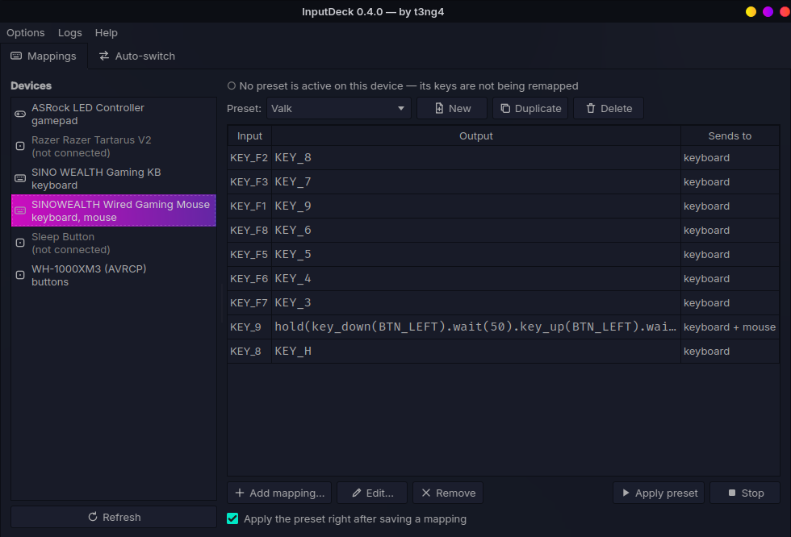
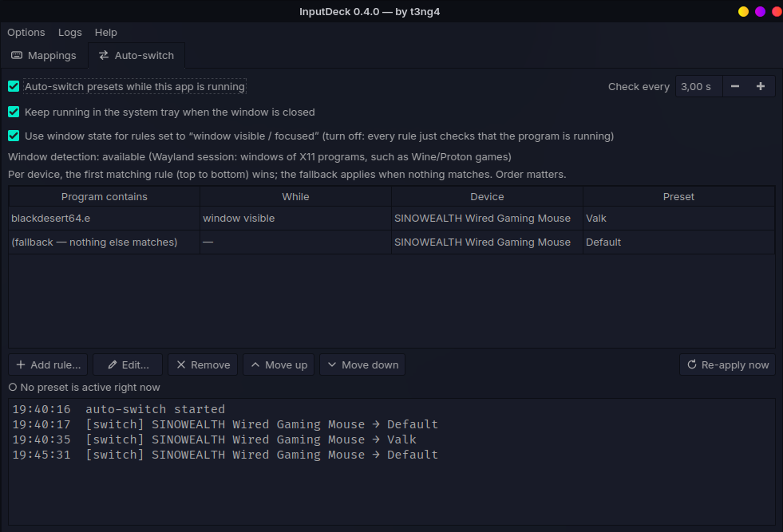

<p align="center">
  
</p>

<h1 align="center">InputDeck</h1>

<p align="center">
  Hotkeys, macro recording and per-app presets for Linux input devices.<br>
  One graphical app, with or without <a href="https://github.com/sezanzeb/input-remapper">input-remapper</a>.
</p>

<p align="center">
  <a href="https://github.com/t3ng4/inputdeck/actions/workflows/tests.yml"></a>
  
  
  
</p>

---

<p align="center">
  
  
</p>
<p align="center"><sub>Left: remap buttons per device. Right: auto-switch presets per program, here only while the game's window is on screen.</sub></p>

## What it does

* **Pick a device, press a key, say what it should do.** Keyboards, mice, gamepads and headset/media
  buttons are detected automatically. You *record* the input by pressing it, and the output as a key, a
  hotkey (`Ctrl+C`) or a **macro** recorded from real key/mouse presses, including the timing.
* **Macro library.** Save a macro under a name, then right-click any input → *Assign a saved macro*, or
  *Change input…* to move a macro to another button.
* **Loops.** Repeat while a button is held, or toggle on/off, with an adjustable delay (auto-clicker style).
* **Auto-switch per program.** Rules like "when `game.exe` runs, use preset *Game* on my mouse", optionally
  only while its window is on screen, so a minimized or tray-hidden game hands the mouse back to your
  desktop preset. Runs in the app (tray) or headless as a systemd user service.
* **Always shows what is active.** The running preset is marked in the device list, the preset list and a
  banner, so you never have to guess.
* **Two engines, your choice.**
  * **input-remapper** daemon: mature, supports everything it supports.
  * **Built-in engine** *(experimental)*: no input-remapper needed. Reads and writes the same preset files.
* **Safe by design.** Warns before a preset can swallow your left click, backs up every preset before
  writing it, moves deleted presets to a trash folder, can stop everything with one chord
  (<kbd>Ctrl</kbd>+<kbd>Alt</kbd>+<kbd>Shift</kbd>+<kbd>Esc</kbd>) and has a *Reset to defaults* that never
  touches your presets.

Works on Wayland and X11 (it talks to the kernel, not the display server).

## Quick start

```bash
git clone https://github.com/t3ng4/inputdeck.git
cd inputdeck
./install.sh                 # installs dependencies for Arch / Debian / Fedora families, adds a launcher
./install.sh --setup-access  # one time: allow reading input devices (then log out and in)
inputdeck --check            # checklist of anything still missing
inputdeck
```

Full instructions, other distributions, autostart and troubleshooting: **[docs/INSTALL.md](docs/INSTALL.md)**.
A task-by-task tour: **[docs/USAGE.md](docs/USAGE.md)**.

## Requirements

* Linux, Python 3.9+
* PyQt6 and python-evdev (the installer fetches them from your distribution)
* Permission to read `/dev/input` (membership in the `input` group); the built-in engine additionally needs
  write access to `/dev/uinput` (`./install.sh --setup-access` sets both up)
* *Optional:* [input-remapper](https://github.com/sezanzeb/input-remapper) 2.x, if you prefer its daemon
* *Optional:* `xprop` (`xorg-xprop`, `x11-utils` or `xorg-x11-utils`) for rules that react to a program's
  window being visible, focused or minimized; the installer offers it

## Choosing an engine

|  | input-remapper daemon | Built-in engine (experimental) |
|---|---|---|
| Needs input-remapper installed | yes | **no** |
| Key / button / combination → key, hotkey, macro | yes | yes |
| Macro functions `key`, `key_down`, `key_up`, `wait`, `repeat`, `hold`, `toggle` | yes | yes |
| Analog mappings (stick → mouse), `if_single`, `modify`, … | yes | not yet (skipped with a warning) |
| Maturity | years of use | new: test it on a mouse before your only keyboard |

The built-in engine does not sync keyboard LEDs (Caps Lock light) back to the real keyboard.
Switch any time under **Options → Remapping engine**. "Automatic" uses input-remapper when it is installed.
If the built-in engine ever misbehaves: <kbd>Ctrl</kbd>+<kbd>Alt</kbd>+<kbd>Shift</kbd>+<kbd>Esc</kbd>, or
**Options → Reset to defaults**, or `inputdeck --reset`.

## Command line

| Command | Does |
|---|---|
| `inputdeck` | start the GUI (`--tray` to start hidden) |
| `inputdeck --check` | print a setup checklist |
| `inputdeck --daemon` | headless auto-switch (for a systemd user service: `./install.sh --service`) |
| `inputdeck --reset` | stop all remapping and the built-in engine, reset InputDeck's settings (never touches presets, rules or macros) |
| `inputdeck --engine-stop` | stop the built-in engine |
| `inputdeck --version` | version and credits |

## Where things are stored

| What | Where |
|---|---|
| Presets | `~/.config/input-remapper-2/presets` (input-remapper's own format and folder; `~/.config/inputdeck/presets` if input-remapper is not installed) |
| Auto-switch rules, settings, macro library | `~/.config/inputdeck/` |
| Backups, trash, logs | `~/.local/share/inputdeck/` (also reachable from the **Logs** menu) |

## Contributing

Bug reports and pull requests are welcome, see [CONTRIBUTING.md](CONTRIBUTING.md). The test suite
(`python3 -m unittest discover -s tests`) needs no hardware, display or extra packages.

## License

[MIT](LICENSE) © 2026 t3ng4. Use it freely; copies and derivatives must keep the copyright notice and
license text, which credits the original author.

## Credits

* Created by **[t3ng4](https://github.com/t3ng4)**.
* Preset format and macro language follow [input-remapper](https://github.com/sezanzeb/input-remapper) by
  sezanzeb (GPL-3.0). InputDeck does not bundle or import it; it only reads and writes compatible files and
  can call its command line tool.
* Auto-switching and macro recording were inspired by Saito's
  [AutoSwitcher & Recorder for Input Remapper](https://github.com/TakeyaSaito/saitos-autoswitcher-recorder-for-inputremapper).
